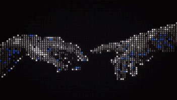
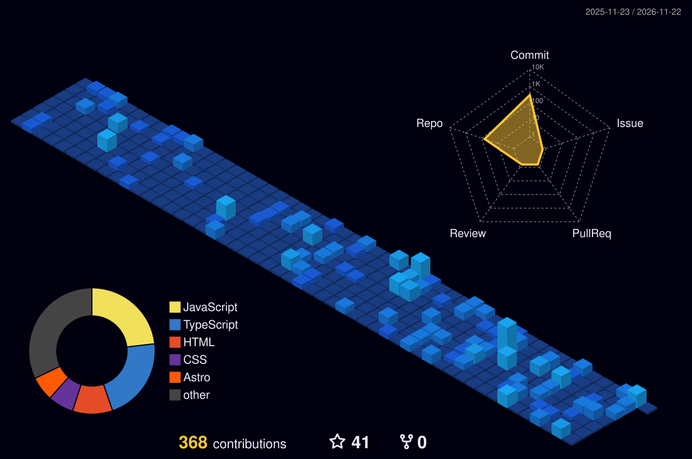

  

<h1 align="center">Hi 👋🏻, Imma Malika</h1>

<h3 align="center">Frontend Engineer & UI/UX Designer</h3>

  

<h2 align="center">🚀 About Me</h2>

So here's the coffee ☕ I'm a frontend engineer, UI/UX designer, and yes, also the owner. Basically I wear every hat in the building, mostly because there's nobody else around to wear them (it's fine, I'm fine).

I blend chaotic code, pixel perfect designs, and executive decisions into real, actual, shipped products no cap. I lead projects end to end, which is just a fancy way of saying I do all the work myself while pretending it was a whole team effort.

My days basically go: dream up a concept → build it → break it → fix the bug I definitely just created → repeat until it works → act surprised when it works.

Aggressively hands on, mildly caffeinated, permanently turning wild ideas into reality powered by an unreasonable amount of love, coffee, and water (in that exact order, don't @ me).

 

<h2 align="center">🤝 Connect</h2>

<h2 align="center">💻 Tech Stack</h2>

  

  

<h2 align="center">📊 Contributions</h2>

  

<h2 align="center">⌘ Commit Activity</h2>

  

<h2 align="center">⌘ Quote</h2>

  <em>"Wenn man richtig will, schafft man das."</em>
   
  — Malsky

